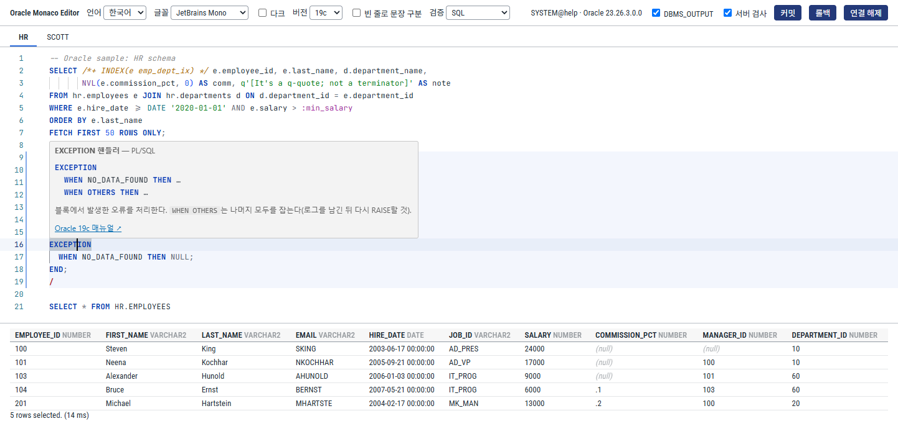

# Oracle용 Monaco 기반 SQL 에디터

> [English](./README.md) · 한국어

Monaco Editor 기반 **Oracle SQL / PL/SQL 에디터** React 컴포넌트.
[`trino-monaco-sql-editor`](https://github.com/DataDynamics-OSS/trino-monaco-sql-editor)의 아키텍처를 기반으로 한다.

- 설계 문서: [`docs/DESIGN.md`](./docs/DESIGN.md)
- 현재 단계: **Phase 4 (Polish)** 완료 — 시그니처 도움말·이름 인자 완성, 호버, 서버 검증(EXPLAIN PLAN), `targetVersion` 문법 게이팅, 멀티 에디터 라우팅 확장, 공통 코어 추출 검토



## 기능

- `oracle` 언어 등록 (Monarch 토크나이저 + language configuration)
  - `q'[…]'` 대체 인용, `N'…'`, 옵티마이저 힌트 `/*+ … */`, 바인드 변수 `:name`,
    치환 변수 `&var`, `@dblink`, `%TYPE`/`%ROWTYPE`, `<<label>>`, 단독 라인 `/` 종결자
  - `$`, `#` 를 식별자 문자로 인식 (`V$SESSION`)
  - `REPLACE(…)` 처럼 `(` 가 뒤따르면 함수, `OR REPLACE` 는 키워드로 구분
- Light / Dark 테마
- 정적 자동완성: 키워드, PL/SQL 키워드, 내장 함수, 내장 패키지(`DBMS_*`, `UTL_*`),
  의사 컬럼, 타입 + 호스트 `metadataProvider`
- **에디터별 라우팅**: 한 페이지에 여러 에디터(탭)가 있어도 completion·signature help·hover 모두 각자의 `metadataProvider` 를 사용
- `targetVersion` (`19c` 기본·최소 / `21c` / `23ai`) 에 따른 키워드 노출과 **문법 게이팅** (아래 참고)
- **시그니처 도움말** (`(` `,`), **이름 인자 `p_name =>` 완성**, **호버** (테이블·컬럼·루틴·시퀀스·PL/SQL 변수)
- **서버 검증** (선택): 실행 없이 `EXPLAIN PLAN` 으로 ORA-00942 / ORA-00904 등을 마커로 표시
- **문장 분리** (SQL*Plus / SQL Developer 규칙)
  - SQL은 `;` 또는 단독 라인 `/` 로 끝나고, `;` 는 실행 텍스트에서 제거
  - PL/SQL(`DECLARE`, `BEGIN`, `CREATE [OR REPLACE] PROCEDURE|FUNCTION|PACKAGE [BODY]|TRIGGER|TYPE …`, `WITH FUNCTION`)은 `/` 까지 한 문장
  - 문자열·q-quote·주석·인용 식별자 안의 `;` `/` 는 무시
  - SQL*Plus 명령(`SET`, `DEFINE`, `PROMPT`, `EXEC`, `@file`, `DESC`, … 약어 포함)은 한 줄 단위, `EXEC p` → `BEGIN p; END;`
  - 선택: 빈 줄로 SQL 문장 구분 (`statementSeparator={{ blankLine: true }}`)
- **치환 변수** `&x` / `&&x` (문자열 안 포함, `DEFINE` 파싱) 및 **바인드 변수** `:x` 탐지 헬퍼
- **액션**

  | 키 | 액션 | 콜백 |
  |---|---|---|
  | `Ctrl/Cmd+Enter` | Run Statement — 커서 위치 문장 (선택 영역이 있으면 그 문장) | `onRunStatement` / `onRunQuery` |
  | `F5` | Run Script — 전체(또는 선택 영역) 문장 목록 | `onRunScript` |
  | `F10` | Explain Plan — 현재 SQL 문장 | `onExplainPlan` |
  | `Shift+F1` / `Ctrl/Cmd+Click` | Show Help — 커서 아래 함수·예약어·의사 컬럼·타입·패키지의 사용법(구문·설명·예제) + `targetVersion` 매뉴얼 링크 | `help` |
  | `Shift+F4` | Describe — 커서 아래 객체 이름(`hr.employees`, `emp@prod`) | `onDescribe` |
  | `Shift+Alt+F` | Prettify | `formatter` |
  | `Ctrl/Cmd+'` | Toggle Case — 문자열·주석 제외 | — |

  여러 문장을 선택하고 `Ctrl/Cmd+Enter` 를 누르면 `onRunScript` 로 전달된다 (없으면 첫 문장만 `onRunStatement`).
- **현재 문장 하이라이트**: 문장이 2개 이상일 때 커서가 있는 문장을 배경 + 거터 바로 표시
- 포매터: 문자열·q-quote·주석·힌트를 그대로 보존, `;`/`/` 종결자와 문장 사이 빈 줄 유지, SQL*Plus 명령은 원문 유지,
  함수 호출 내부(`EXTRACT(YEAR FROM d)`)는 줄바꿈하지 않음, PL/SQL 블록(`DECLARE/BEGIN/EXCEPTION/END`, `IF/ELSIF/ELSE`, `LOOP`, `CASE`, 헤더 `IS/AS`) 들여쓰기

### 문맥 기반 자동완성 (`contextAware`)

Web Worker에서 커서가 있는 **문장 하나만** ANTLR 문법(`src/grammar/OracleSql.g4`)으로 파싱하고,
[antlr4-c3](https://github.com/mike-lischke/antlr4-c3)로 커서 위치에서 문법상 가능한 것만 제안한다.

| 커서 | 제안 |
|---|---|
| `FROM \|` | CTE 이름, 메타데이터 테이블/스키마/시노님, `TABLE` `LATERAL` `ONLY` |
| `FROM hr.\|` | HR 스키마 객체 (메타데이터) |
| `SELECT \| FROM emp e` | 별칭 `e`, 스코프 내 테이블 컬럼, 함수, 패키지, 의사 컬럼, 표현식 키워드 |
| `WHERE e.\|` | 별칭 `e` 테이블의 컬럼만 |
| `x.\|` (CTE·인라인 뷰·커서 루프 레코드) | 문장에서 유도한 컬럼 (메타데이터 조회 없음) |
| `r.\|` (`r emp%ROWTYPE`) / `:new.\|` (트리거) | 해당 테이블 컬럼 |
| `DECLARE v \|` / `CAST(x AS \|)` | 타입, `CONSTANT` 등 |
| `BEGIN \|` | 프로시저/패키지, 선언된 변수·파라미터, `IF` `LOOP` `NULL` … |
| `emp@\|` | DB 링크 (메타데이터) |
| `MERGE … WHEN \|` / `FETCH \|` | `MATCHED` `NOT` / `FIRST` `NEXT` |

- 문장이 선언한 이름을 직접 수집: 테이블 별칭(DML 대상, MERGE 소스 포함), CTE·인라인 뷰 컬럼, PL/SQL 변수·상수·파라미터·커서·예외·타입, 커서 FOR 루프 레코드, `%ROWTYPE` 레코드, 트리거 `:NEW`/`:OLD`
- 사전 이름 삽입 규칙: 소문자·특수문자·예약어가 포함된 이름은 자동으로 `"..."` 인용, 그 외는 `identifierCase` (소문자로 입력 중이면 소문자로 삽입)
- **문법 검증 마커** `validateOnType`: `"sql"`(기본) / `"all"`(PL/SQL 포함) / `false`. 문장별 첫 오류만 표시

`metadataProvider` 는 다음 문맥을 받는다:

```ts
{
  word, text, position,
  expectTable, expectColumn, expectFunction, expectProcedure, expectType, expectDbLink,
  qualifier: ["e"],               // `e.` / `hr.` / `dbms_output.` / `:new.`
  qualifierQuoted: [false],       // 인용된 부분은 대소문자 그대로, 아니면 대문자로 비교
  aliases: [{ alias: "e", table: "hr.employees", kind: "table", dbLink?: "prod" }],
  ctes: [{ name: "x", columns: ["a", "b"] }],
  statementKind: "sql" | "plsql" | "sqlplus" | "none",
}
```

### DB 연결 (Phase 3)

브라우저는 Oracle Net을 쓸 수 없으므로 서버를 거친다. 에디터 쪽은 `OracleTransport` 인터페이스 하나에만 의존한다.

| Transport | 서버 | 특징 |
|---|---|---|
| `createGatewayTransport()` (**권장**) | [`servers/server-node/`](./servers/server-node/README.md) — Fastify + node-oracledb Thin<br>(같은 API: [`servers/server-python/`](./servers/server-python/README.md) FastAPI + python-oracledb, [`servers/server-java/`](./servers/server-java/README.md) Spring Boot + ojdbc11) | **사용자별 전용 Oracle 세션**: 트랜잭션, `ALTER SESSION`, 서버 커서 페이징, `connection.break()` 취소, DBMS_OUTPUT. httpOnly 쿠키 인증, 19c 미만 거부 |
| `createOrdsTransport()` | ORDS REST-Enabled SQL | 서버 개발 불필요. 요청마다 새 세션(트랜잭션·세션 상태 없음), 페이징은 offset 재실행, 취소는 HTTP 중단만 |
| `createMockTransport()` | 없음 | 테스트·오프라인 |

```tsx
import {
  OracleEditor, createGatewayTransport, createOracleMetadataProvider, createOracleQueryRunner,
} from "@datadynamics/oracle-monaco";

const transport = createGatewayTransport({ baseUrl: "/api" });
await transport.login({ connectAlias: "dev", user, password });     // 비밀번호는 이 1회만 전송

const metadata = createOracleMetadataProvider({ transport });          // ALL_* 딕셔너리, 캐시, 시노님 추적
const runner = createOracleQueryRunner({
  transport, metadata,
  onBindPrompt: async (names) => askUser(names),                       // :bind 값
  onSubstitutionPrompt: async (name) => askUser(name),                 // &var 값
});

<OracleEditor
  contextAware
  metadataProvider={metadata}
  executionErrors={errors}                                             // ORA 오류·PL/SQL 컴파일 오류 마커
  onRunStatement={async (stmt) => {
    try { const r = await runner.run(stmt); show(r); setErrors(r.compileErrors ?? []); }
    catch (e) { setErrors([e]); }                                      // OracleQueryError: code, line, column
  }}
  onRunScript={async (stmts) => { for await (const r of runner.runScript(stmts)) append(r); }}
  onExplainPlan={async (stmt) => showPlan((await runner.explain(stmt)).lines)}
  onDescribe={async (name) => show(await runner.describe(name))}
/>;
```

러너(`createOracleQueryRunner`)가 처리하는 것:

- `&var` / `&&var` 치환 (`DEFINE`/`UNDEFINE`, 미정의 시 프롬프트), `:bind` 값 (호출 인자 → 기억된 값 → 프롬프트)
- SQL*Plus 명령: `SET SERVEROUTPUT ON|OFF`, `SET DEFINE`, `DEFINE`, `UNDEFINE`, `PROMPT`, `EXEC`, `DESC`, `WHENEVER SQLERROR EXIT|CONTINUE` (그 외는 무시 메시지)
- 결과 페이징(`fetchMore`), 취소(`AbortSignal` → 서버 `break()`), SQL*Plus식 피드백 (`3 rows updated.`, `Procedure created with compilation errors.`)
- ORA 오류 위치를 **문서 좌표**로 (치환 변수로 길이가 바뀌어도 원문 위치로 환산), PL/SQL 생성 후 `ALL_ERRORS` → 컴파일 오류 위치
- DDL·`ALTER SESSION SET CURRENT_SCHEMA` 후 메타데이터 캐시 무효화, `explain()` (EXPLAIN PLAN + DBMS_XPLAN), `describe()` (시노님 추적)

### 시그니처 도움말 · 호버 · 서버 검증 (Phase 4)

| 기능 | 동작 | 출처 |
|---|---|---|
| Signature help | `nvl(a, \|` → 활성 파라미터 강조, 오버로드 선택(인자 수·이름 인자 기준), `DECODE`/`COALESCE` 반복 인자 | 내장 SQL 함수 표 (오프라인) + `metadataProvider.signatures` (`ALL_ARGUMENTS`) |
| 이름 인자 완성 | `hr_pkg.raise_salary(\|` → `P_EMP_ID =>`, `P_PCT =>` (이미 쓴 이름·위치 인자로 소비된 파라미터 제외) | `metadataProvider.signatures` |
| Hover | 별칭 `e` → 테이블 + 컬럼 목록·코멘트, `e.salary` → 타입·NOT NULL·코멘트, 시노님 경유 표시, `pkg.proc` 시그니처, 시퀀스 설정, `INVALID` 상태, PL/SQL 변수 타입, 내장 함수 시그니처 | `metadataProvider.describe` + 워커 스코프(`contextAware`) |
| 내장 도움말 | `Shift+F1` / `Ctrl/Cmd+Click` (또는 호버): 내장 함수 ~250개, 예약어·문장 ~90개(`CREATE TABLE`, PL/SQL `FETCH` vs `FETCH FIRST`, `FOR` 루프 vs `FOR UPDATE`, `%TYPE` 등 문맥 구분), 의사 컬럼, 타입, Oracle 제공 패키지 → 구문·설명·예제 + Oracle 19c/21c/23ai 매뉴얼 링크. `hover={false}` 여도 단축키로는 열린다 | `oracle/docs.ts` (오프라인) |
| 서버 검증 | 입력이 멈추면(기본 1.2초) 바뀐 SELECT/DML 문장만 `EXPLAIN PLAN FOR …` → ORA 오류 위치 마커 (owner `oracle-server`) | `createServerValidator({ transport })` |
| 버전 게이팅 | `targetVersion` 보다 새로운 구문: 완성에서 숨김(`IF [NOT] EXISTS` 의 `IF`, `QUALIFY`, …), 검증에서 경고(`IF [NOT] EXISTS`, `FROM` 없는 `SELECT`, SQL `BOOLEAN`/`TRUE`/`FALSE`) | 워커 |

```tsx
const metadata = createOracleMetadataProvider({ transport });   // signatures() / describe() 포함
const validator = createServerValidator({
  transport,
  substitutionVariables: runner.variables,   // 정의된 &var 는 치환, 미정의면 건너뜀
  paused: () => running,                      // 같은 세션에서 실행 중이면 보류
});

<OracleEditor contextAware metadataProvider={metadata} serverValidator={validator} targetVersion="19c" />;
```

- 서버 검증은 **SELECT / WITH / INSERT / UPDATE / DELETE / MERGE 만** 보낸다. DDL은 파싱 시점에 실행되므로 절대 보내지 않는다. PL/SQL·SQL*Plus 명령도 제외.
- 바인드는 NULL 로 바인딩(계획에 영향 없음), PLAN_TABLE 행은 직후 삭제(ORDS는 요청마다 세션이 끝나므로 생략).
  클라이언트 문법 오류가 있는 문장, PLAN_TABLE 없음·뷰 기반 객체 권한(ORA-01039)·세션 오류 같은 환경 오류는 마커로 만들지 않는다.
- 결과는 문장 텍스트 기준으로 캐시되어 다른 문장을 편집해도 다시 보내지 않는다. `serverValidator` 가 바뀌면(재접속 등) 캐시를 비운다.
- 게이트웨이 세션은 커넥션 하나이므로 긴 쿼리 실행 중에는 EXPLAIN 이 그 뒤에 줄을 선다 → `paused` 로 보류하거나 검증 전용 세션(별도 transport)을 쓴다.
- 직접 쓰는 provider 라면 함수에 `signatures` / `describe` 속성을 붙이거나 `signatureProvider` / `describeProvider` prop 으로 넘긴다.

## 개발

```bash
npm install
npm run dev          # 데모 (오프라인 샘플 메타데이터, HR / SCOTT 탭)
npm test             # scanner / splitter / format / keywords / core / grammar / runner / metadata / signature (Node, DB 불필요)
npm run test:gateway # servers/server-node 게이트웨이 HTTP·세션·인증 테스트 (가짜 드라이버, DB 불필요)
npm run gateway      # 게이트웨이 실행 (CONNECT_ALIASES 등 — servers/server-node/README.md)
(cd servers/server-python && .venv/bin/python -m pytest)   # Python 게이트웨이 테스트 (servers/server-python/README.md)
(cd servers/server-java && mvn test)                      # Java 게이트웨이 테스트 (servers/server-java/README.md)
npm run gen:parser   # src/grammar/OracleSql.g4 → src/generated (Java 필요)
npm run typecheck
npm run build        # dist/ (ES module + d.ts)
npm run build:demo   # dist-demo/
```

실제 DB 대상 E2E (선택):

```bash
# 1) Oracle Free 컨테이너 + 게이트웨이 (셋 중 하나)
docker run -d -p 1521:1521 -e ORACLE_PASSWORD=... -e APP_USER=scott -e APP_USER_PASSWORD=... gvenzl/oracle-free:23-slim-faststart
export CONNECT_ALIASES='{"free":{"connectString":"localhost:1521/FREEPDB1"}}' SECURE_COOKIE=false ALLOW_HEADER_AUTH=true
npm run gateway                                                         # Node
(cd servers/server-python && .venv/bin/python -m oracle_monaco_gateway) # Python
(cd servers/server-java && mvn -q package -DskipTests && java -jar target/oracle-monaco-gateway.jar)  # Java

# 2) 게이트웨이 경유 테스트 / 데모 (Vite가 /api 를 게이트웨이로 프록시, VITE_ORACLE_GATEWAY 로 변경)
ORACLE_GATEWAY_URL=http://127.0.0.1:8787/api ORACLE_ALIAS=free ORACLE_USER=scott ORACLE_PASSWORD=... npm run test:live
npm run dev

# 3) ORDS (restEnabledSql.active=true, ORDS.ENABLE_SCHEMA 필요)
ORDS_URL=http://ords-host:8080/ords ORDS_SCHEMA=scott ORDS_USER=scott ORDS_PASSWORD=... npm run test:live:ords
```

데모는 Monaco를 CDN이 아닌 로컬 번들에서 로드한다 (`src/main.tsx` 의 `loader.config({ monaco })`).
라이브러리 자체는 `@monaco-editor/react` 기본 동작을 따르므로, 폐쇄망에서는 호스트 앱도 같은 설정을 권장한다.

## 사용

```tsx
import { OracleEditor, toExecutable } from "@datadynamics/oracle-monaco";

<OracleEditor
  value={sql}
  onChange={setSql}
  theme="dark"
  targetVersion="19c"
  metadataProvider={async ({ word }) => lookup(word)}   // [{ label, kind: "table" | "column" | …, detail }]
  onRunStatement={(stmt) => run(toExecutable(stmt))}     // stmt.kind: "sql" | "plsql" | "sqlplus"
  onRunScript={(stmts) => runAll(stmts)}
  onExplainPlan={(stmt) => explain(stmt.text)}
  onDescribe={(name) => describe(name)}
/>;
```

## Props

| Prop | Type | Default | 설명 |
|---|---|---|---|
| `value` / `defaultValue` / `onChange` | | | 제어/비제어 값 |
| `onRunStatement` | `(stmt: SqlStatement, editor) => void` | — | `Ctrl/Cmd+Enter` |
| `onRunScript` | `(stmts: SqlStatement[], editor) => void` | — | `F5`, 다중 문장 선택 + `Ctrl/Cmd+Enter` |
| `onExplainPlan` | `(stmt: SqlStatement, editor) => void` | — | `F10` (SQL 문장만) |
| `onDescribe` | `(objectName, editor) => void` | — | `Shift+F4` |
| `onRunQuery` | `(sql, editor) => void` | — | trino-monaco 호환: 실행할 텍스트 (`EXEC` 변환 포함, SQL*Plus 전용 명령 제외) |
| `highlightCurrentStatement` | `boolean` | `true` | 현재 문장 하이라이트 |
| `statementSeparator` | `{ blankLine?: boolean }` | `{}` | 빈 줄 문장 구분 |
| `theme` | `"light" \| "dark"` | `"light"` | |
| `readOnly` | `boolean` | `false` | |
| `languageElements` | `Partial<OracleLanguageElements>` | 내장 | 자동완성 목록 override |
| `targetVersion` | `"19c" \| "21c" \| "23ai"` | `"19c"` | 버전별 키워드 + 문법 게이팅(완성 숨김·검증 경고) |
| `keywordCase` | `"upper" \| "lower" \| "preserve"` | `"preserve"` | 삽입 케이스 |
| `metadataProvider` | `MetadataProvider` | — | 스키마/테이블/컬럼 제안. `signatures` / `describe` 속성이 있으면 시그니처 도움말·호버에도 사용 |
| `signatureHelp` | `boolean` | `true` | `(` `,` 파라미터 힌트 |
| `hover` | `boolean` | `true` | 이름 호버 |
| `help` | `boolean` | `true` | `Shift+F1` / `Ctrl/Cmd+Click` 도움말 (`hover={false}` 일 때도 동작) |
| `fontFamily` | `string` | D2Coding Ligature 스택 | 코드 글꼴 (CSS font-family). 추천 목록: `ORACLE_EDITOR_FONTS` (D2Coding Ligature, JetBrains Mono, Fira Code, Cascadia Code, Source Code Pro, IBM Plex Mono). 글꼴 파일은 호스트 페이지가 로드하고, 로드되면 에디터가 글자 폭을 다시 잰다 |
| `fontLigatures` | `boolean` | `true` | 합자(`=>` `!=` `>=` `\|\|`) 표시 |
| `locale` | `"en" \| "ko" \| "ja" \| "zh"` | `"en"` | UI 언어: 액션 라벨(컨텍스트 메뉴), 호버, 내장 도움말 설명, 시그니처 도움말 설명, 구문 검사 메시지 |
| `signatureProvider` | `SignatureSource` | `metadataProvider.signatures` | 루틴 오버로드 공급자 |
| `describeProvider` | `DescribeSource` | `metadataProvider.describe` | 호버용 이름 해석 |
| `serverValidator` | `ServerValidator` | — | `createServerValidator(...)`: EXPLAIN PLAN 서버 검증 (없으면 끔) |
| `serverValidateDelay` | `number` | `1200` | 서버 검증 디바운스(ms) |
| `contextAware` | `boolean` | `false` | ANTLR/c3 워커 문맥 자동완성 + 검증 (마운트 시 1회 적용) |
| `validateOnType` | `"sql" \| "all" \| false` | `"sql"` | 문법 오류 마커 (`contextAware` 일 때) |
| `identifierCase` | `"upper" \| "lower" \| "preserve"` | `"preserve"` | 사전 이름 삽입 케이스 (인용 필요한 이름은 항상 인용) |
| `executionErrors` | `ExecutionMarker[]` | — | 실행/컴파일 오류 마커 (`OracleQueryError`, `CompileError` 그대로 전달 가능) |
| `formatter` | `Formatter` | 내장 | |
| `options` / `height` / `width` / `className` / `onMount` | | | Monaco 옵션 등 |

> 구문 하이라이트용 키워드는 Monaco 인스턴스당 최초 등록 시 1회 적용된다. `languageElements`·`targetVersion` 변경은 자동완성에 반영된다.

## 구조

```
src/
  OracleEditor.tsx       React 컴포넌트
  index.ts               공개 API
  core/                  방언 무관 (trino-monaco에서 추출)
    completionItems.ts   applyCase / dedupeByLabel
    completionRouter.ts  모델 URI별 provider 라우팅 (completion / signature help / hover)
    editorActions.ts     selectedOrAll / prettifyEditor
    styles.ts            1회 스타일 주입
  oracle/
    language.ts          Monarch 토크나이저 + language configuration
    keywords.ts          키워드 / 함수 / 타입 / 의사 컬럼 / 패키지 / 버전별 키워드
    scanner.ts           경량 lexical scanner (문자열·주석·힌트 구분)
    splitter.ts          문장 분리 (SQL / PL/SQL / SQL*Plus)
    variables.ts         치환 변수 / DEFINE / 바인드 변수
    editorStatements.ts  문장 캐시, 선택 영역 분리, 객체 이름 추출, Toggle Case
    format.ts            포매터 (PL/SQL 들여쓰기)
    identifiers.ts       대문자 정규화 / 인용 판단 / 이름 분해
    metadata.ts          createOracleMetadataProvider (ALL_* 딕셔너리)
    runner.ts            createOracleQueryRunner (문장·스크립트 실행, SQL*Plus 명령, 오류 위치)
    explain.ts           EXPLAIN PLAN + DBMS_XPLAN
    signatures.ts        호출 위치 분석(callAt), 내장 함수 시그니처, 오버로드/파라미터 선택
    signatureHelp.ts     Monaco SignatureHelpProvider + `name =>` 완성 항목
    hover.ts             Monaco HoverProvider + 객체 정보 Markdown 렌더링
    docs.ts              내장 도움말 (함수·예약어·의사 컬럼·타입·패키지) + 매뉴얼 URL
    fonts.ts             추천 코드 글꼴 목록 (ORACLE_EDITOR_FONTS)
    i18n/                UI 문자열(en/ko/ja/zh) + 도움말 번역(docs.ko/ja/zh.ts, `OracleDocEntry.id` 키)
    serverValidate.ts    createServerValidator (EXPLAIN PLAN, 실행 없음)
    transport/           types (OracleTransport) · gateway · ords · mock · auth
    completion.ts        정적 completion provider + 메타데이터 타입
    setup.ts             언어/테마/라우터 등록
    themes.ts / options.ts
  grammar/OracleSql.g4   문맥 완성용 축약 문법 (SQL + PL/SQL 서브셋)
  generated/             ANTLR 생성물 (npm run gen:parser)
  worker/
    completionCore.ts    문장 파싱 + antlr4-c3 + 스코프 수집 (순수 로직)
    versionGate.ts       targetVersion 키워드 필터 + 신규 구문 경고
    contextProvider.ts   문맥 → Monaco 제안 (+ metadataProvider 호출)
    completion.worker.ts / client.ts / protocol.ts
  App.tsx / main.tsx     데모
servers/                 게이트웨이 (같은 API·보안 모델)
  server-node/           Fastify + node-oracledb Thin — servers/server-node/README.md
  server-python/         FastAPI + python-oracledb Thin
  server-java/           Spring Boot 4 + ojdbc11
scripts/                 Node 테스트 (tsx), test-live*.ts (실 DB), gen-parser.mjs
```

## 라이선스

[MIT](./LICENSE). 서드파티 고지는 [`NOTICE`](./NOTICE) 참고.
